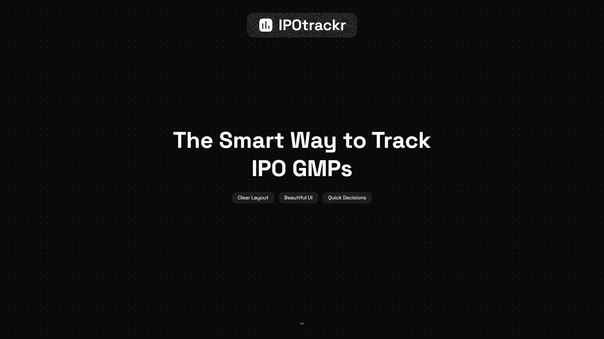
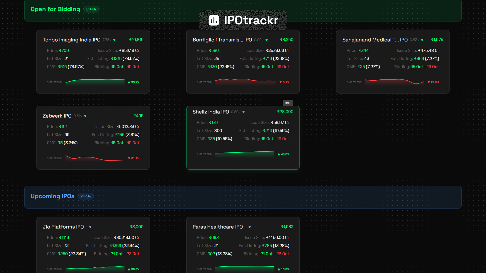
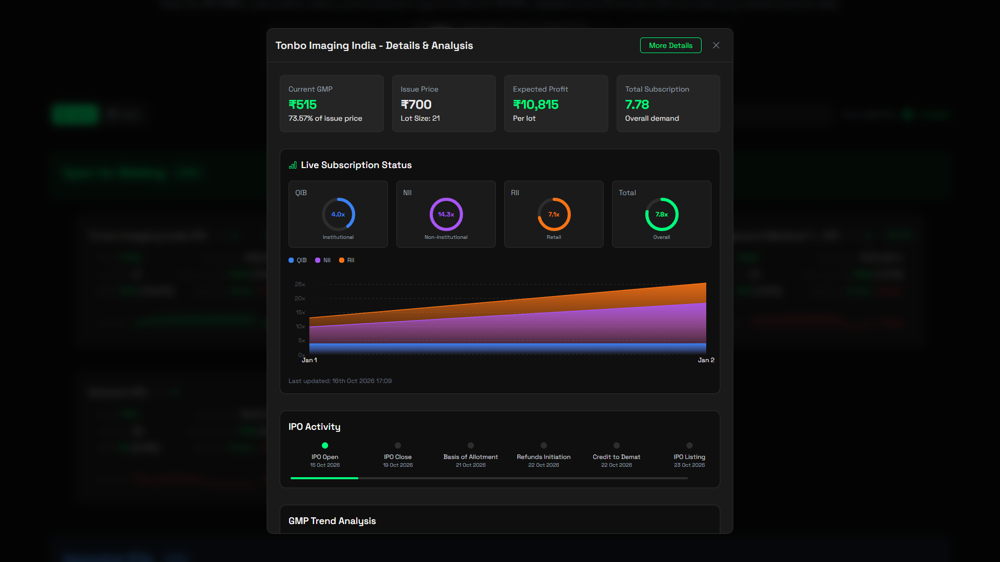

<div align="center">
  

  # IPOtrackr

  **Real-time IPO Grey Market Premium (GMP) and subscription tracker**

  [Live Website](https://ipotrackr.davincin.eu.org) &bull; [Issues](https://github.com/DewanshNehra/ipotrackr/issues)
</div>

---



## Features

- **Live IPO GMP Tracking**: Real-time Grey Market Premium rates, estimated listing gains, and percentages.
- **Interactive Charts and Sparklines**: Historical GMP trend visualizations and price movement indicators.
- **Subscription Status**: Breakdown of live bidding data across QIB, NII, and retail categories.
- **Filtering and Search**: Status filters (Open, Upcoming, Closed, Listed) and toggle between Mainboard and SME IPOs.
- **Progressive Web App**: Installable on mobile and desktop with offline support.
- **Analytics (Optional)**: Support for Google Analytics 4 and self-hosted Umami if configured.

---

<div align="center">
  
  
</div>

---

## Getting Started

### Prerequisites

- Node.js >= 20
- pnpm >= 10 (`corepack enable pnpm`)

### Installation

1. Clone the repository:
   ```bash
   git clone https://github.com/DewanshNehra/ipotrackr.git
   cd ipotrackr
   ```

2. Install dependencies:
   ```bash
   pnpm install
   ```

3. Set up environment variables:
   ```bash
   cp .env.production.example .env.local
   ```

4. Start the development server:
   ```bash
   pnpm dev
   ```
   Open [http://localhost:3000](http://localhost:3000) in your browser.

---

## Docker Deployment

1. Set up `.env.production` with your configuration (analytics variables are optional):
   ```env
   # Optional
   NEXT_PUBLIC_GA_ID=
   NEXT_PUBLIC_UMAMI_WEBSITE_ID=
   NEXT_PUBLIC_UMAMI_SCRIPT_URL=
   ```

2. Build and start the container:
   ```bash
   docker compose up -d --build
   ```

The application runs on port `6972` as defined in `docker-compose.yml`.

